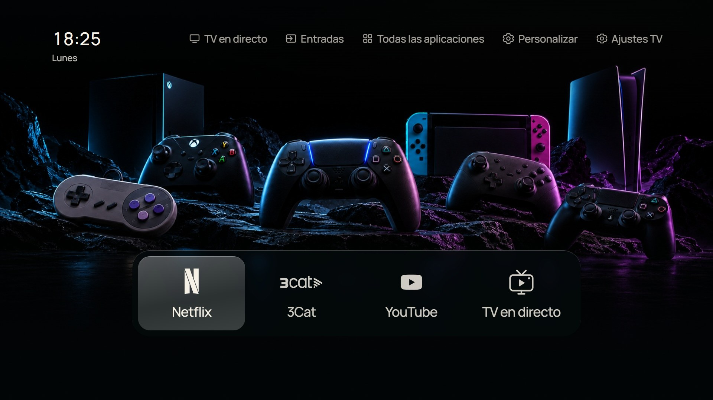

# CleanFrame · Samsung S85F OLED

A personal TV launcher adapted for the **Samsung TQ48S85FAEXXC (55-inch S85F OLED)**, based on [nthnclrk/CleanFrame](https://github.com/nthnclrk/CleanFrame). The TV interface is in Spanish. Documentation and screenshot captions are available in both languages.

Un menú personal para la **Samsung TQ48S85FAEXXC (S85F OLED de 55 pulgadas)**, basado en CleanFrame. Interfaz en español; documentación y pies de captura en español e inglés.

**[English guide](docs/games/README.en.md) · [Guía en español](docs/games/README.es.md)**

[Project record / Registro del proyecto](docs/games/PROJECT.md) · [Screenshots / Capturas](docs/games/SCREENSHOTS.md) · [Upstream README](README.upstream.md)



## Features / Funciones

- Installed TV apps only, with a configurable, reorderable carousel. / Solo aplicaciones instaladas, con carrusel configurable y ordenable.
- HDMI shortcuts with editable names and monochrome Steam, Nintendo Switch and PS5 icons. / Accesos HDMI con nombres editables e iconos monocromos.
- Live TV preview, scrollable channel list, tuning and optional carousel shortcut. / TDT con vista previa, lista desplazable, cambio de canal y acceso opcional en el carrusel.
- Separate launcher customization and Samsung quick settings. / Personalización del menú y ajustes rápidos de Samsung separados.
- 24-hour clock and weekday; consistent focus and visible Back/Home controls. / Hora de 24 horas, día de la semana y controles visibles para volver e ir a inicio.
- 22 backgrounds in 11 day/night pairs, with design masters and generation prompts. / 22 fondos en 11 parejas día/noche, con originales y descripciones de generación.

## Preview / Vista previa

Requires Node.js 22.13+ or 24+, Python 3.10+, and npm. / Requiere Node.js 22.13+ o 24+, Python 3.10+ y npm.

```sh
git clone https://github.com/pettersdark/Samsung-TQ48S85FAEXXC-CleanFrame.git
cd Samsung-TQ48S85FAEXXC-CleanFrame
npm ci
python scripts/preview.py --public-fonts
```

On macOS/Linux, use `python3` if needed. Open http://localhost:4795/home/. Use arrows, Enter and Escape. Actual TV actions require a compatible TV. / En macOS/Linux usa `python3` si corresponde. Abre la dirección anterior; usa flechas, Intro y Escape. Las funciones del televisor requieren una TV compatible.

## Confirmed on this TV / Confirmado en esta TV

Samsung TQ55S85FAUXXC · S85F OLED 55-inch (2025) · Tizen 9 ARMv7 · firmware T-PTMFDEUC-0090-1301.0. App installation/opening, physical Home and the requested standby startup test were confirmed by the owner on 2 November 2026. HDMI, channel tuning and Samsung settings still need individual confirmation on this TV.

Instalación y apertura de la app, botón Inicio y arranque desde espera confirmados por el propietario el 2 de noviembre de 2026. HDMI, sintonización de canales y ajustes Samsung pendientes de comprobación individual en esta TV.

## Installation and limits / Instalación y límites

Read the language guide before installing. Use your own Samsung developer certificates and SDK-generated app identity. This repository contains source, assets and documentation, without personal keys, signed packages or device recovery state. On this TV the owner confirmed physical Home routing and launcher startup in a standby test. Native integration is firmware-specific; **one successful test does not guarantee every future power-on**.

Lee la guía antes de instalar. Usa certificados de desarrollador propios y una identidad de aplicación generada por el SDK. El repositorio contiene código, recursos y documentación; excluye claves personales, paquetes firmados y datos de recuperación. El propietario confirmó Inicio y el arranque en una prueba de espera. La integración depende del firmware; **una prueba correcta no garantiza todos los encendidos futuros**.

## Credits and licences / Créditos y licencias

CleanFrame by Nathan Clark and contributors; games-TV adaptation for pettersdark. Preserve [LICENSE](LICENSE) and [THIRD_PARTY_NOTICES.md](THIRD_PARTY_NOTICES.md). Brand logos retain their owners' rights. Generated wallpaper provenance is recorded in `app/assets/wallpapers/SOURCES.json`; prompts and selected masters are in `design/backgrounds/`. No Samsung or platform endorsement is claimed.
