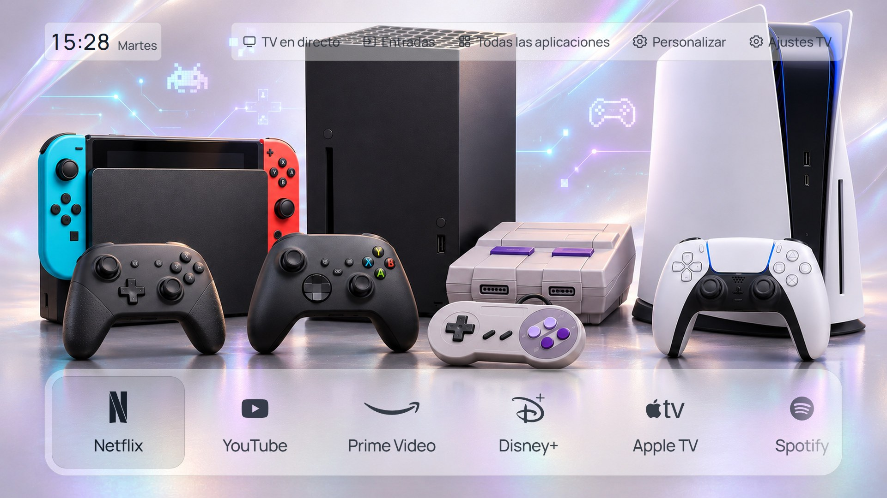

# CleanFrame Samsung QE43Q7FAAUXXH

Personal Spanish launcher for the Samsung 43-inch Q7F, based on [CleanFrame by Nathan Clark](https://github.com/nthnclrk/CleanFrame). / Menú personal en español para la Samsung Q7F de 43 pulgadas.

**[English guide](docs/q7f43/README.en.md) · [Guía en español](docs/q7f43/README.es.md) · [Project record / Registro](docs/q7f43/PROJECT.md) · [Release 1.1](docs/releases/1.1.md)**


## Features / Funciones

- Installed apps with an unlimited, reorderable carousel; HDMI shortcuts with editable names and monochrome icons. / Apps instaladas, carrusel sin límite configurable y accesos HDMI con nombres e iconos.
- Live TV preview, scrollable channel list and full-screen tuning on OK; separate Samsung settings and launcher customization. / TDT con lista desplazable, pantalla completa al pulsar y ajustes separados.
- Seven offline wallpaper packages, 52 images in 26 day/night pairs, rotation and configurable day/night schedule. / Siete paquetes sin conexión, 52 fondos en 26 parejas, rotación y horario día/noche.
- Single-line 24-hour time and weekday, balanced margins, Soft/Frost/Clear materials on carousel, header and clock. / Hora de 24 horas y día en una línea, márgenes equilibrados y materiales en carrusel, menú y reloj.

## Confirmed on this TV / Confirmado en esta TV

**QE43Q7FAAUXXH · Tizen 9.0 ARMv7 · T-RSLFDEUC-0090-1300.9.** On 3 November 2026, the owner confirmed CleanFrame opening, physical Home returning from YouTube to CleanFrame, Back opening Samsung Home and two normal power-on cycles from YouTube starting CleanFrame.

El 3 de noviembre de 2026 el propietario confirmó apertura, Casa desde YouTube a CleanFrame, Atrás al menú Samsung y arranque en CleanFrame en dos encendidos normales desde YouTube. HDMI, canales y ajustes rápidos no se han validado individualmente en este modelo.

Native integration was configured separately with an exact private recovery baseline. The public download does not configure Home/startup. These tests do not guarantee behavior after firmware changes. / La integración nativa se configuró por separado con recuperación privada. La descarga pública no configura Casa ni arranque; las pruebas no garantizan el comportamiento tras cambios de firmware.

## Preview / Vista previa

Requires Node.js 22.13+ or 24+, Python 3.10+ and npm. / Requiere Node.js 22.13+ o 24+, Python 3.10+ y npm.

```sh
git clone https://github.com/pettersdark/Samsung-QE43Q7FAAUXXH-CleanFrame.git
cd Samsung-QE43Q7FAAUXXH-CleanFrame
npm ci
python scripts/preview.py --public-fonts
```

Use `python3` on systems that require it. Open http://localhost:4795/home/; arrows, Enter and Escape control the preview. Device actions require a TV. / Usa `python3` si corresponde. Abre la dirección anterior; flechas, Intro y Escape. Las acciones de TV requieren el dispositivo.



These images show the shared interface in a browser preview, not photographs of this TV. / Las imágenes muestran la interfaz compartida en el navegador; no son fotografías de este televisor.

## Installation / Instalación

Read the language guide. Use your own Samsung certificates and SDK-generated identity. The release widget is unsigned and contains public fonts. Certificates, signed personal widgets, device identifiers, addresses and recovery settings are excluded. Historical native tools retain their reference guards and are not an automatic installer for this model.

Lee la guía de tu idioma. Usa certificados Samsung e identidad SDK propios. El paquete público no está firmado y usa fuentes públicas. Se excluyen certificados, paquetes personales firmados, identificadores, direcciones y valores de recuperación. Los ayudantes históricos no son un instalador automático para este modelo.

## Credits / Créditos

CleanFrame by Nathan Clark and contributors; adaptation for pettersdark. Retain [LICENSE](LICENSE) and [THIRD_PARTY_NOTICES.md](THIRD_PARTY_NOTICES.md). Wallpaper masters and prompts are in `design/packs/`. Brand marks belong to their owners. No Samsung endorsement is claimed. / Conserva licencias y avisos; originales y prompts en `design/packs/`. Las marcas pertenecen a sus propietarios.
